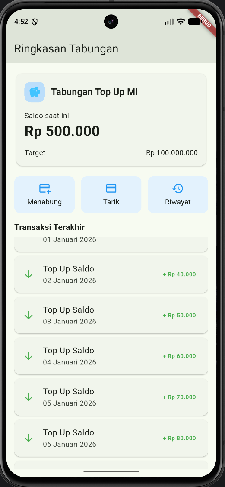
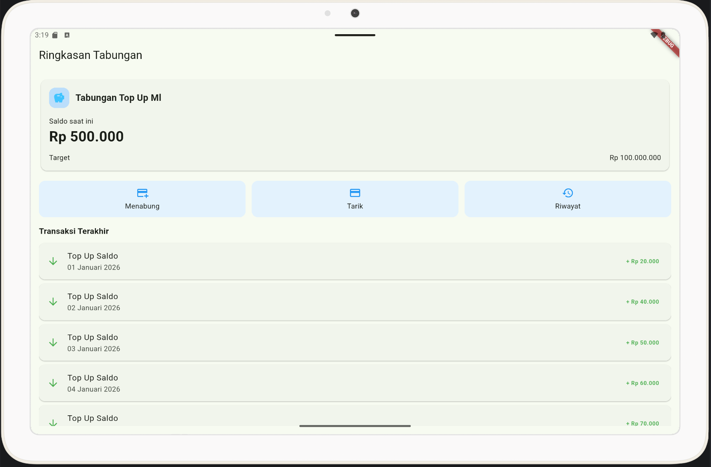

## TUGAS TALENTPATH PERTEMUAN 3 TabungKu
## Pemrograman Mobile

## MAHASISWA:
- **Nama: **Firaas Ferdinal
- **NIM: **20240801011

## Fitur Yang Ditampilan
- Kartu info tabungan (nama tabungan, saldo, target)
- Tiga tombol kategori (Menabung, Tarik, Riwayat)
- Daftar transaksi (judul, tanggal, nominal)

## Cara Menjalankan
1. Pastikan Flutter SDK sudah terpasang (cek dengan `flutter doctor`).
2. Clone repositori ini:
   ```
   git clone https://github.com/YouxAIBot/tabungku_layout.git
   cd tabungku_layout
   ```
3. Unduh dependensi:
   ```
   flutter pub get
   ```
4. Jalankan di emulator atau perangkat:
   ```
   flutter run
   ```

## Tangkapan Layar
Diuji pada ponsel (potret) dan tablet sesuai ketentuan tugas.

| Ponsel (Pixel 8, potret) | Tablet (Pixel Tablet) |
|---|---|
|  |  |

Tangkapan layar progres per langkah tersedia di folder `docs/progres/`.